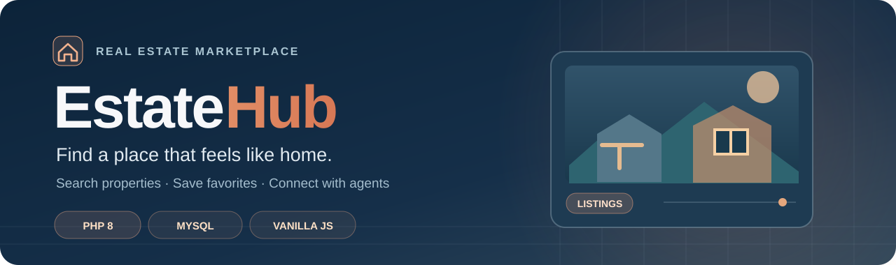
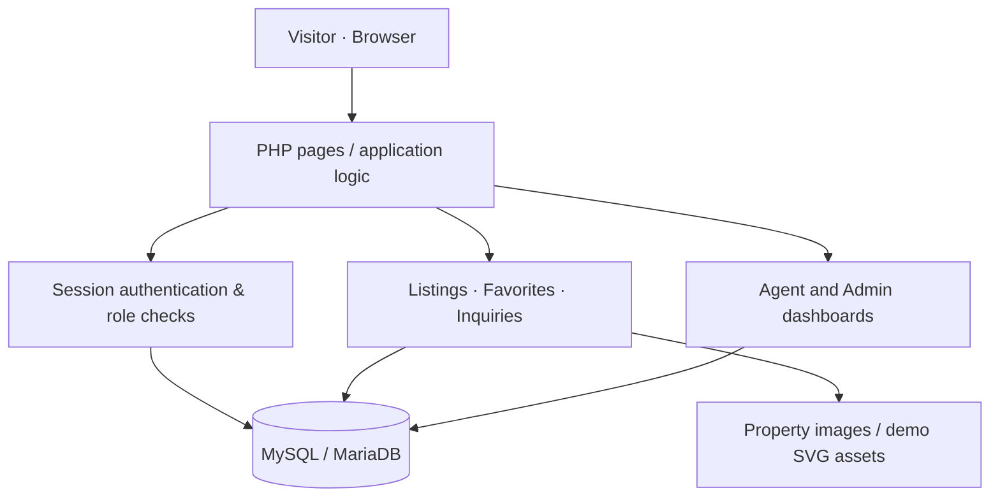

<a id="top"></a>

<div align="center">



<br />

<strong>A responsive property marketplace built with PHP and MySQL, from discovery and saved homes to agent listings and administrative workflows.</strong>

<br /><br />


<br />


<br /><br />

<a href="#-features"><strong>Features</strong></a> &nbsp;·&nbsp;
<a href="#-architecture"><strong>Architecture</strong></a> &nbsp;·&nbsp;
<a href="#-getting-started"><strong>Get started</strong></a> &nbsp;·&nbsp;
<a href="#-security-notes"><strong>Security</strong></a>

</div>

---

## 🏡 The idea

**Property discovery should be simple, visual, and intuitive.**

EstateHub is a full-stack real estate classifieds project inspired by the browsing and seller–buyer experience of platforms such as OLX. It focuses specifically on **property listings** rather than general-purpose classifieds.

Users can search homes and offices, save favorites, explore listing galleries, and contact sellers. Agents can manage their own listings, while administrators supervise the marketplace.

<table>
<tr>
<td align="center" width="33%">
<h3>🔎 Buyers & renters</h3>
Browse listings, filter results, save favorite properties, and send inquiries.
</td>
<td align="center" width="33%">
<h3>🏘️ Agents</h3>
Publish listings with photos, edit inventory, and view property inquiries.
</td>
<td align="center" width="34%">
<h3>🛡️ Administrators</h3>
Manage platform users, listing statuses, and incoming inquiries.
</td>
</tr>
</table>

> [!NOTE]
> EstateHub is an **independent portfolio prototype**, not affiliated with OLX. The seed data is fictional and includes illustrative properties in several US locations; the project is not a live Lebanon property marketplace.

## ✨ Features

| Feature | What it does |
|:--|:--|
| 🏠 **Property discovery** | Browse apartments, houses, villas, and offices |
| 🎚️ **Advanced filtering** | Search by keywords, location, type, bedroom count, and price, with sorting and pagination |
| 🖼️ **Listing detail pages** | Property information, image gallery, and location/map embedding |
| ❤️ **Favorites** | Save and remove properties through asynchronous requests |
| ✉️ **Buyer inquiries** | Contact agents about individual listings |
| 🔐 **Authentication** | Register, log in, and manage profiles using PHP sessions |
| 🧑‍💼 **Agent workspace** | Create, edit, delete, and monitor property listings |
| 📊 **Admin workspace** | Review platform statistics, users, listings, and inquiries |
| 📱 **Responsive design** | Layouts designed for mobile and desktop browsers |

## 🏗 Architecture

The application is deliberately framework-light: PHP pages and shared helpers handle requests and render the user interface, with MySQL providing the relational data store.



### Technology stack

| Layer | Technologies |
|:--|:--|
| **Backend** | PHP 8+, PDO prepared statements |
| **Database** | MySQL / MariaDB |
| **Frontend** | HTML5, CSS3, vanilla JavaScript |
| **Authentication** | PHP sessions and password hashing |
| **Interface** | Lucide icons, responsive styling, AJAX interactions |
| **Local development** | PHP built-in server or Apache with PHP |

## 📂 Project structure

```text
EstateHub/
├── index.php                 # Landing page and featured properties
├── auth/                     # Registration, login, profile
├── listings/                 # Browse, create, edit, view, favorites
├── agent/                    # Agent management and inquiries
├── admin/                    # Admin dashboards and moderation
├── config/db.php             # Environment-based PDO configuration
├── includes/                 # Shared helpers, layout, header/footer
├── assets/
│   ├── css/                  # Responsive styles
│   ├── js/                   # Frontend interactions
│   └── images/               # Shared fallback assets
├── uploads/                  # Demo SVG images; private uploads ignored
├── setup.php                 # Destructive, CLI-only demo database seeding
└── README.md
```

> Live uploads, local credentials, virtual environments, and developer-specific settings are intentionally omitted from the public repository.

## 🚀 Getting started

### Prerequisites

- **PHP 8+** with PDO MySQL, MySQL-compatible driver, and Fileinfo extension
- **MySQL 5.7+** or compatible MariaDB
- A local database account allowed to create tables (and, for the initial demo setup, the database)
- Git and a terminal (examples use Windows PowerShell)

### 1. Clone the project

```powershell
git clone https://github.com/mhmdalali1/EstateHub.git
cd EstateHub
```

### 2. Configure the database

Set environment variables in your **current PowerShell session**. Replace each placeholder with a value specific to your local MySQL installation:

```powershell
$env:ESTATEHUB_DB_HOST = "localhost"
$env:ESTATEHUB_DB_NAME = "real_estate_portal"
$env:ESTATEHUB_DB_USER = "YOUR_LOCAL_MYSQL_USER"
$env:ESTATEHUB_DB_PASSWORD = "YOUR_LOCAL_MYSQL_PASSWORD"
$env:ESTATEHUB_SITE_URL = "http://localhost:8000"
```

The application reads these through `config/db.php`. **Do not put personal passwords in source files or Git.**

### 3. Seed an isolated demo database (optional)

> [!WARNING]
> **Destructive operation:** `setup.php` drops and recreates existing tables. Run it **only against a disposable demo database** and never against a database that contains important information. It cannot be launched through HTTP.

Provide a separate, unique password of at least 12 characters for fictional demo users and explicitly authorize the reset:

```powershell
$env:ESTATEHUB_DEMO_PASSWORD = "YOUR_UNIQUE_DEMO_PASSWORD_12_PLUS"
$env:ESTATEHUB_CONFIRM_DEMO_RESET = "YES"

php setup.php

Remove-Item Env:ESTATEHUB_CONFIRM_DEMO_RESET
```

The script seeds fictional accounts for an admin, two agents, and two regular users, plus sample listings, favorites, and inquiries. You can sign in with one of the documented demonstration emails (for example `admin@estatehub.com`) and **the demo password you supplied**, not a built-in default.

The setup generates a `.setup_done` marker that prevents accidental reruns. Do not manually remove it unless you intend to reset the disposable database again.

### 4. Run the website

```powershell
php -S localhost:8000
```

Open **http://localhost:8000** in your browser.

If you prefer XAMPP or Apache, configure the virtual host and `ESTATEHUB_SITE_URL` accordingly.

<details>
<summary><strong>Test the main workflows</strong></summary>

1. **Visitor:** Browse listings and try keyword and property-type filters.
2. **Buyer:** Register, sign in, save a favorite, and send an inquiry.
3. **Agent:** Create a property listing, upload an image, edit a listing, and review inquiries.
4. **Admin:** Manage property statuses and user roles through the admin dashboard.

Use fictional details and a disposable development database.

</details>

## 🧪 Quality checks

You can verify PHP syntax across the tracked application files:

```powershell
Get-ChildItem -Recurse -Filter *.php | ForEach-Object { php -l $_.FullName }
```

Syntax validation alone does **not** establish that the website, MySQL connection, file uploads, and all authentication flows work correctly end-to-end. A real integration test is still recommended.

## 🔒 Security notes

- Database credentials are read from **environment variables**, not hard-coded into the published PHP configuration.
- The seed script is **CLI-only**, requires explicit reset confirmation, and no longer creates predictable default passwords.
- Uploaded image MIME types are checked from the actual file data rather than trusting filenames.
- The public repository includes only clearly named **fictional demo SVG artwork**; private uploaded files are excluded.
- PHP pages use prepared PDO queries and session-based access controls, but the application has **not** undergone an independent security audit.
- Before real deployment, review CSRF protection, authorization, file handling, HTTPS, session security, and rate limiting.
- Any credentials previously committed to the original university repository or shared elsewhere must be **rotated**. A fresh Git history does not erase previous exposure.

## 🎓 Project background

EstateHub demonstrates end-to-end web development with database-backed search, user roles, and administrative workflows. It is included here as a **personal software engineering portfolio project**.

### License

No open-source license is currently supplied. The code is visible for portfolio review; redistribution and reuse are not automatically authorized.

---

<div align="center">
<strong>ESTATEHUB</strong><br/>
<sub>Browse smarter. Find your place.</sub><br/><br/>
<a href="#top">Back to top</a>
</div>
